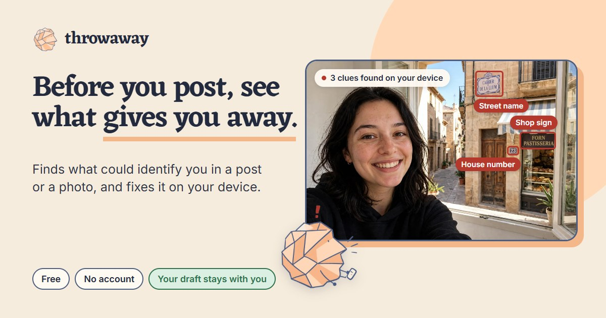
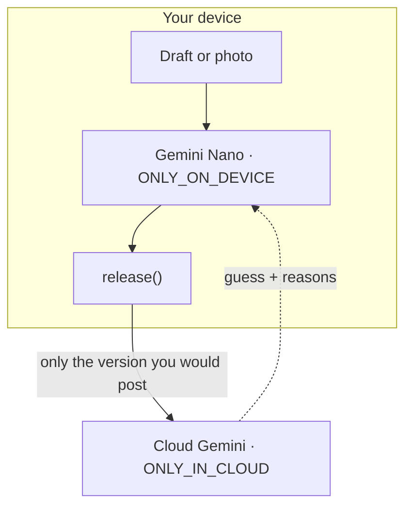

# Throwaway

**Before you post anonymously, let an AI try to unmask you.**

[](https://throwaway-hybrid.web.app)

**[Open the app](https://throwaway-hybrid.web.app/app/)** (Chrome with Gemini Nano) · **[Watch a recorded run](https://throwaway-hybrid.web.app/app/?demo)** (any browser) · **[How it works](https://throwaway-hybrid.web.app)** · **[Demo video](https://youtu.be/g9BGaIio3pU)** (2:34) · No sign-up

In 2013, a stylometry analysis unmasked J. K. Rowling as "Robert Galbraith" from her writing alone. A cloud AI can now attempt the same in seconds: in our runs in Chrome (the recorded demo replays one), it picked the author of an anonymous employer review out of ten writers, 10 times out of 10. Asking a chatbot to "make it anonymous" hands it the very draft you want to protect, and nothing checks the result.

Your words give away **who** you are. Your photos give away **where** you are. Throwaway attacks both before anyone else does: **Gemini Nano finds and fixes what gives you away on your device, and a cloud Gemini, through Firebase AI Logic, attacks only the version you would post.** Your original never leaves the device.

| Threat | The attacker asks | On your device | In the cloud |
|---|---|---|---|
| Text | Who wrote this? | Stylometric fingerprint (plain JavaScript); identifying details and rewrite (Gemini Nano) | A lineup attack: ten public writers, shuffled, you are never labeled |
| Photo | Where was this taken? | Location clues on a 4×4 grid (Gemini Nano, each read up close), faces found on the device (MediaPipe), blurring around them | A geolocation attack on the version you would post |

For a text (a Glassdoor review, a tip to a journalist, a post from an alt account):

1. **Find, on your device.** Burrows' Delta over function words and your habit phrases, compared with writing you have already made public, says how much your style stands out (the risk *before*, with no cloud call: the demo's draft ranks #1 of 10). Gemini Nano finds the identifying details. 0 bytes sent.
2. **Fix, on your device.** Fixed rules generalise the identifying details ("three years" → "several years"). Then Gemini Nano, through Firebase AI Logic (`ONLY_ON_DEVICE`), rewrites the draft without your habits. With no local model, Throwaway does not fall back to the cloud: fixed rules flag counts, dates and capitalised names (and, if you ask, generalise counts with the word they count, dates and names before a noun), and you rewrite the rest.
3. **Test, in the cloud.** Gemini, through Firebase AI Logic (`ONLY_IN_CLOUD`), gets the version you would post plus a lineup of ten public writers and tries to pick the author. It is never told which candidate is you. **Only the version you would post ever reaches the cloud.** If it still finds you, Nano rewrites again with the attacker's reasons, and the cloud tests again, until you are at chance level, one in ten.
4. **Take it with you.** Copy the version you checked, or compare it word by word with your original. For a photo, download the blurred version.

**Why the original is never tested in the cloud (22-nov).** The first version showed the risk by attacking your untouched draft. But the app runs on Gemini's free plan, where Google may use what is sent to improve its products and people may review it, and its terms ask not to send sensitive data. So the risk *before* is now measured on the device (the fingerprint rank, what Gemini Nano reads in a photo), and the framework's loop runs without a baseline (`redTeam` without `asIs`). The recorded demo still offers to test the original, since it sends nothing; a billed project can turn it on with `VITE_ALLOW_AS_IS_TEST=true`.

To fingerprint you rather than the demo writer, paste writing you have already published under your name. It stays in the tab and is never stored; for the attack it is one of the ten public candidates.

## Try it

- **Live:** [throwaway-hybrid.web.app/app/](https://throwaway-hybrid.web.app/app/). The home page, [throwaway-hybrid.web.app](https://throwaway-hybrid.web.app), explains it in two minutes. Use Chrome 139+ on a desktop with Gemini Nano (Chrome's Prompt API; about 22 GB of free disk, and a GPU with more than 4 GB of VRAM or 16 GB of RAM). If Nano is not available, enable `chrome://flags/#prompt-api-for-gemini-nano-multimodal-input` and restart Chrome. Without a local model, Throwaway does not hand the private steps to the cloud: it switches to a degraded mode where you edit and it attacks.
- **Recorded run:** [throwaway-hybrid.web.app/app/?demo](https://throwaway-hybrid.web.app/app/?demo) replays a real run recorded in Chrome, through the same framework. It works in any browser.
- **Languages:** the landing page and the app speak English and Spanish (`/es/`, `?lang=es`, or the app's ⋯ menu). The checks themselves are tuned for posts in English, and the app says so when a post is not.

### Real or recorded?

- **Live** (`/app/`): every model call is real. Gemini Nano runs on your device and Gemini runs in the cloud, both through Firebase AI Logic, with App Check.
- **Recorded run** (`/app/?demo`): the model answers of real runs (16 to 23-nov-2026) are replayed through the same framework, so the demo video is reproducible. The fingerprint, the fixed rules, the privacy guard, the shuffled lineups and the receipt run live, and the Firebase SDK is not even loaded.
- To run live mode yourself you need a Firebase project: see [Run it](#run-it).

## How Firebase AI Logic hybrid inference is used

Each step picks its inference mode on purpose. Your draft and your photo are the secret, so everything that reads them runs on your device; the cloud only plays the attacker.



| Step | Firebase AI Logic mode | What leaves the device |
|---|---|---|
| Fingerprint | none (plain JavaScript) | nothing |
| Find identifying details | `ONLY_ON_DEVICE` (Gemini Nano) | nothing |
| Generalise those details, and every count and date, in the draft | none (fixed rules, plain JavaScript) | nothing |
| Rewrite the style, then the meaning check | `ONLY_ON_DEVICE` (Gemini Nano) | nothing |
| Check the final text for added numbers, dates or names | none (plain JavaScript) | nothing |
| Find the location clues in a photo | `ONLY_ON_DEVICE` (Gemini Nano, image input) | nothing |
| Attack (the app calls it a "test") | `ONLY_IN_CLOUD` (`gemini-3.5-flash-lite`; `gemini-3.1-flash-lite` as a backup while it is busy, and the receipt says so) | the fixed text or blurred photo you are about to publish, plus public writing. On Gemini's free plan Google may use it to improve its products and people may review it, so the original is never sent |

```ts
// src/framework/firebase.ts, simplified
initializeAppCheck(app, { provider: new ReCaptchaEnterpriseProvider(siteKey), isTokenAutoRefreshEnabled: true });
const ai = getAI(app, { backend: new GoogleAIBackend() });
const defender = getGenerativeModel(ai, { mode: InferenceMode.ONLY_ON_DEVICE, inCloudParams: { model } }); // Gemini Nano
const attacker = getGenerativeModel(ai, { mode: InferenceMode.ONLY_IN_CLOUD, inCloudParams: { model } }); // Gemini in the cloud
```

**Why not `PREFER_ON_DEVICE`?** On a device without a local model it would fall back to the cloud, and your private draft would go with it. Throwaway degrades instead: it says what it can no longer check, you edit, and it attacks.

Code: [`src/framework/firebase.ts`](src/framework/firebase.ts) · [`src/engine/stylometry.ts`](src/engine/stylometry.ts)

## The framework: local defender, cloud attacker

Throwaway is the reference app of a small TypeScript framework on top of Firebase AI Logic hybrid inference. A **threat** is four functions:

```ts
interface Threat<Input, Clue, Verdict> {
  findClues(input: Private<Input>, kit): Promise<Clue[]>;        // on-device
  sanitize(input: Private<Input>, clues, feedback, kit): Promise<Publishable<Input>>; // on-device
  attack(published: Publishable<Input>, kit): Promise<Verdict>;  // cloud
  exposed(verdict: Verdict): boolean;
}
```

`redTeam(threat, input, kit)` runs the loop: sanitize on the device, attack, sanitize again with the attacker's feedback, until the attacker stops finding you. An optional `asIs` baseline attacks the untouched input first; the app uses it only in the recorded demo.

**The privacy contract is enforced, not promised:**

- `Private<T>` (your draft, your photo) can only be read by `LocalModel` (Firebase AI Logic `ONLY_ON_DEVICE`). Passing it to `CloudModel` (`ONLY_IN_CLOUD`) is a **type error**, so the app does not build; the run-time check below catches anything that slips past the types.
- If private data is smuggled into a cloud call, a run-time taint check **blocks the call** and logs it as `blocked` in the ledger. It compares every outgoing part, alone and joined, in a normalised form: windows of about 32 letters (7–8 words) after folding case, accents, invisible characters, look-alike letters, HTML, URL and JSON escapes and up to three layers of base64, in any script. It also matches the private photo (raw, base64, `data:` URL or binary string) and your real coordinates. Try "Try to leak the original", under "For developers".
- The only way out is `release()`, which refuses content that still carries the private original unless the user confirms they would publish it as-is.
- If the SDK ever served a local call from the cloud, `LocalModel` throws.
- Every call lands in a ledger: where it ran, how long, how many bytes left the device.
- No third-party requests besides Firebase and its App Check: fonts are bundled, so opening Throwaway tells no font CDN who you are. The recorded demo (`?demo`) does not even load the Firebase SDK.

For a photo: Nano marks the grid cells that reveal where you are (street plaque, house number, shop sign) and reads each one up close, a face detector on the device (MediaPipe) finds the faces, the device blurs those cells around the faces (each with an edge of an eighth of a cell, so a sign or a number on a cell's line is hidden whole), and a cloud geolocation attacker estimates where the **masked** photo was taken. If it still narrows you down, it says which cells helped, and the loop hides those too. In the recorded run: a readable address 215 m from the spot → "Tokyo, Japan", 10,559 km off.

Code: [`src/framework/`](src/framework) · threats: [`authorship.ts`](src/threats/authorship.ts), [`location.ts`](src/threats/location.ts) · tests: `npm test`

## Run it

```bash
npm install
npm run dev
```

Copy `.env.example` to `.env.local` and fill in your Firebase config to enable live mode. Never commit `.env.local`.

No Gemini Nano in your Chrome? Add `?demo` to the URL (or click **Replay a recorded run**). The app replays recorded model answers through the same framework: privacy guard, fixed rules, ledger and shuffled lineups.

Testing or recording a video with your own photo but not your real location? Add `#truth=<lat>,<lon>` to the address (for example `#truth=38.7116,-9.1297`). It sets the location the photo is scored against, and a URL fragment never reaches a server.

### Deploy (Firebase Hosting)

1. Create a reCAPTCHA Enterprise (Fraud Defense) **web key** for your Hosting domains, score-based (no challenge). Do not add `localhost`.
2. Register it in Firebase console → App Check → your web app. App Check is enforced for Firebase AI Logic; locally the debug provider is used instead.
3. Put the site key in `.env.production.local` as `VITE_RECAPTCHA_SITE_KEY`. Site keys are public, but the file stays local.
4. Run `npm run deploy`: tests, build, then `firebase deploy --only hosting`. [`firebase.json`](firebase.json) adds security headers: nosniff, no framing, a strict-origin referrer (reCAPTCHA needs the origin), camera and microphone off, geolocation for this origin only.

## Measured, not claimed

Live runs through Firebase AI Logic on 15 and 16-nov-2026 (cloud attacker: `gemini-3.5-flash-lite`, ~1 s per call):

| Test | Result |
|---|---|
| Text, draft as-is, lineup of 10 same-field writers | Attacker picked the real author **10/10** ("So, honestly / basically / anyway / sorry not sorry") |
| Text, a rewrite we wrote by hand (15-nov) | **0/10** (chance is 1/10) |
| Text, rewritten **by Gemini Nano on the device** (Chrome) | **0/10**: the attacker now picks the "formal, academic" writer |
| Text, full on-device pipeline in Chrome (16-nov, v4: Nano rewrites, then generalises the details sentence by sentence) | **10/10 → 0/10**, no specific detail left, fingerprint #10 of 10, meaning check 5/5. But Nano wrote our prompt's examples into the text (see below), so the pipeline changed |
| Text, full on-device pipeline in Chrome (16-nov, v5: fixed rules generalise the details first, then Nano rewrites the style) | **10/10 → 0/10** (9 picks of one decoy, 1 of another). Five details generalised in 3 ms (today's fixed rules also catch "six months", so the demo shows six), nothing added by the rewrite, meaning check 6/6, fingerprint #10 of 10. The rewrite stage took ~25 s on a laptop (v4: ~60 s). The demo replayed this run until 22-nov |
| Text, the same pipeline keeping your tone (22-nov, the default since then: the rewrite stays in the first person and keeps the draft's claims) | Rafa's Chrome: **0/10** (one decoy 9 times, another once), meaning check 6/6. The same text tested again from the live preview (23-nov): **0/10**, the corporate decoy all ten times, "formal, professional register". Testers still read it as an HR statement |
| Text, the same pipeline as a forum post (23-nov, the default since then: first person, short sentences, no corporate words) | Rafa's Chrome: **1/9** (one decoy 6 times), meaning check 6/6. The same text from the live preview: **3/9**, then **1/10**: **5 of 28** in all, where a blind guess gets about 3. The fingerprint ranks the author last of 10; when the attacker picks her it cites the genre, a first-person rant, and quotes habits that are not in the text. The demo replays the 1/10 run, the only one complete with its reasons |
| Photo (the demo selfie, a made-up photo of Palma), as-is (22-nov) | "Carrer de la Llum, Alcúdia, Mallorca", high confidence: it read the street plaque. The wrong town (51 km off), but a street name anyone can look up: red |
| Photo, clues found by Gemini Nano **on the device** (Rafa's Chrome, 22-nov) | The street plaque (cell 3) and the bakery sign (cell 8), each read up close. It never flagged the house number, which sits on the line between cells 8 and 12 |
| Photo, cells 3 and 8 blurred on the device, each with an edge of an eighth of a cell (23-nov) | "Valletta, Malta", medium confidence: 1,119 km off. The same photo three more times: Valletta again, then "Valldemossa, Mallorca" twice (16 km off). No run read a street name or a number. Without the edge, half the house number stayed sharp; that photo gave "Alcúdia, Mallorca" |
| Photo, the drawn scene of the first demo (15/16-nov) | As-is: "Carrer de la Llum, 23, Palma" (it read the plaque, the number and the sign). Blurred: "Tokyo, Japan", low confidence |
| Photo test set (16-nov): four AI-generated phone photos (Muse Image), real attacker, cells masked by hand | |
| · Lisbon street with a readable plaque | As-is: "Rua de São Miguel, Alfama", 34 m off (it read the plaque). With 3 cells masked it read the house number. With 8 of 16 masked: still "Lisbon", ~0.9 km, high confidence (red) |
| · Paris window with a blue street sign | As-is: 27 m off (it read "Rue Oberkampf"). Sign masked: "Paris", ~2 km (amber: it knows the city, not the street) |
| · Tokyo lane with shop signs | "Tokyo", ~3 km, low confidence (amber). Another run: "Kyoto", 360 km off (green) |
| · Selfie by a window with only trees | "Unknown": safe as-is |
| **Photo bench (23-nov): nine AI-made photos with 17 faces and 14 things that give the place away** (street names, house numbers, plates, shop signs), marked by hand. Gemini Nano on the device in Rafa's Chrome (an Intel integrated GPU), one run per photo, nothing sent | **No face touched** (one forehead grazed by 1 %, under the 5 % allowed). **13 of 14 identifiers at least 80 % hidden, 11 of them at least 95 %**. The miss: the BAKER STREET roundel, 79 %, because it touches a head and faces win. A control photo with nothing to hide stayed untouched. Median blurred share 14 %; about 2 to 4 minutes per photo on that laptop. Paris, London and New York ran on the build before the last two reading fixes, the same day |

What the live runs taught us (and changed):

- **Decoys must share your topic.** With off-topic decoys, the rewritten review was still attributed to its author 3/9 times, by subject ("the only one writing about design teams"). The nine other writers now come from your own field: design, software, healthcare, finance, teaching, or retail and hospitality, matched on your device to the public writing you add (you can pick another). The field follows your writing, not the post: with your writing about design and nine finance writers next to it, a finance post would point the attacker away from you by subject, and the attack would look safe. Until you add your writing, the sample writer and her designers stand in for you. The other fields' texts load only when you open that section.
- **An attacker's confidence is not your exposure.** A confident wrong guess ("Venice, 5 km") looked like a leak. The photo threat now scores the guess against your real location, on your device, and the location never leaves it.
- **Hiding your style is not hiding your story.** Gemini Nano's rewrite beat the lineup (0/10) but kept "Lisbon office", "three years" and "Figma migration": your manager would still know it was you. Five live iterations taught us to **let the small model decide what identifies you, and let deterministic code make sure it is gone**:
  - Pasted replacements broke the grammar ("the most recent a period") and chased generic words Nano over-flagged ("team", "transition").
  - A whole-text rewrite copied a placeholder from our own prompt ("what you wrote instead") seven times, and Nano's own meaning check still passed it.
  - Sentence by sentence, Nano kept all five details.
  - When it did generalise them, it copied the examples from our instructions into the wrong sentences. It invented "This was an internal project involving a much smaller team" and garbled the team-size claim, and its meaning check still said 5/5.

  Now the details never reach the rewrite. Gemini Nano finds them on the device, and fixed rules, with no AI, generalise them in the draft: "three years" → "several years", "after the March reorg" → "after the reorg", "the Lisbon office" → "the office", "6 people to 2" → "several people to a few". Nano then rewrites the style of a draft that has no details left, so it can neither keep them nor fill them in. Counts and dates go even when Nano does not flag them: in one live run on the public URL it missed "6 people to 2", and the final text still said "six individuals" while the app called it safe. A deterministic check catches any number, date or name the rewrite adds, comparing each count with the word it counts ("six individuals" is not "six months"), and the same rules generalise it. Nano went from five calls to three, and the meaning check still compares the original and the final text on the device. Throwaway does not say "safe" while a specific detail is left.
- **Small models copy examples wherever they are in the prompt**, not only in JSON templates: placeholders, then the examples in our instructions. The prompts now carry none.
- **A readable address is exposure even when the AI gets the city wrong.** On the as-is photo a live run read the plaque and the house number but said "Barcelona" (the street is fictional), 206 km from the scene. Scoring only by distance called that safe; a person would simply search that address everywhere. Street names, house numbers and plates now count as exposure on their own.
- **Your face is not a location clue.** Gemini Nano also flagged the person in the selfie; people are now excluded, and a face detector on the device (MediaPipe) keeps every face out of the masks: on a bench of nine photos with 17 faces, no face was touched (23-nov).
- **Masking hides your street, not always your city.** On realistic test photos, masking took the attacker from your exact address to your city, but a street where every cell says Lisbon (tiles, cobblestones, tram tracks) still says Lisbon with half the photo masked. A single 50 km threshold painted a low-confidence "Tokyo" (a city of millions) as red as your exact address, so Throwaway now has three levels:
  - **Red:** it found your street (an address it can read, or a guess within 1 km).
  - **Amber:** it knows your city, not your street.
  - **Green:** the wrong place.

  Only red keeps the loop masking. Amber says so plainly, and suggests cropping or another photo if your city is the secret.
- **Masking has to leave a photo worth posting.** On a Paris street, Gemini Nano flagged a facade in every cell, and masking everything the two models pointed at pixelated the whole photo. Masking now has a budget: street names, house numbers and plates always go; then signs and landmarks, up to a quarter of the photo; facades and trees, which say the city and not the street, are left. Each flagged cell is read up close first, and a cell where Gemini Nano reads nothing the clue names is dropped as the wrong cell. If the attacker still finds you, Throwaway says to crop the photo or post another one.
- **A shop sign is not an address.** In one run the attacker described Tokyo signs ("ramen", "sake shop") as text, guessed Kyoto 360 km off, and the app said "it read your address". Only text that is an address (street names, house numbers, phone numbers) and plates count as an identifier now.
- **"Unknown" is not a place.** When the attacker could not place a photo it answered "Unknown" at 0,0, and the app first showed "off by 4,510 km" (the distance to that point). A guess with no place or coordinates is now treated as no guess.
- **On-device structured output is set per model instance.** Gemini Nano ignored `generationConfig` and wrapped JSON in markdown; the framework now passes a JSON schema as Chrome's `responseConstraint`.
- `gemini-3.8-flash` took 40–60 s per call on the free tier, too slow for a ten-attempt lineup, so the attacker defaults to Flash-Lite.

The demo mode (`?demo`) replays real runs. Text: the details (five flagged by Nano on 16-nov, a sixth by the fixed rules), the attack before (10/10, 16-nov), Nano's rewrite as a forum post (Rafa's Chrome, 23-nov), the meaning check and the attack after (1/10, 23-nov). Photo: the selfie, with Gemini Nano's scans and readings from the photo bench (22-nov) and the cloud's answers as-is and blurred (22 and 23-nov).

## Security and privacy hardening

- **Content Security Policy, enforced.** `script-src 'self'` plus the reCAPTCHA hosts App Check needs, with no inline scripts and no `eval`; `connect-src` lists only Firebase AI Logic, App Check and reCAPTCHA; `object-src 'none'` and `frame-ancestors 'none'`. It ran in report-only mode on production first, through the landing page, the recorded run and a live attack: the only finding was tiny font files that Vite inlined as `data:` URLs, now emitted as files.
- **Headers:** HSTS with preload, `X-Content-Type-Options: nosniff`, `X-Frame-Options: DENY`, `Referrer-Policy: strict-origin`, `Cross-Origin-Opener-Policy: same-origin`, and a `Permissions-Policy` that turns off the camera and the microphone.
- **App Check** with reCAPTCHA Enterprise, so only this web app can call the model.
- **No accounts, no storage, no analytics and no cookies of ours.** The fonts are bundled, so the recorded run makes no requests to third parties.
- **Reporting:** [`/.well-known/security.txt`](https://throwaway-hybrid.web.app/.well-known/security.txt) and [SECURITY.md](SECURITY.md).
- **Lighthouse** on production, mobile (16-nov-2026): landing page 99 / 100 / 100 / 100 and app 98 / 100 / 100 / 100 (performance, accessibility, best practices, SEO), with no layout shift. The landing page scores 100 in all four on desktop.

## Limits we know about

- A cloud provider that sees many attempts could intersect lineups (you are the one constant). Throwaway limits attempts; decoy lineups are on the roadmap.
- Stylometry on short texts is noisy. Under 50 words the app shows no rank ("too short to tell"); above that it shows how far the rank moves when the text's words are resampled 100 times (the demo post's #1 is only "low" confidence: likely #1 to #7). The rank is a signal, not proof: the cloud attack is the real test.
- Names and places depend on the local model: the fixed rules generalise those only when Gemini Nano flags them. With Gemini Nano, counts, dates, links, email addresses, @usernames and phone numbers are always generalised. Without it, you rewrite by hand: the button generalises counts with the word they count, dates and names before a noun, and leaves a bare number ("under 21") or a name on its own to you. The rules and the fingerprint are tuned for English. The rules' wording is plain, not elegant. Codes such as "24/7" are left as they are and stay reported.
- The meaning check runs on the small local model and is lenient (live, it passed a garbled sentence). Read the final text before you post it.
- Blurring hides what a model can read today; it is not a guarantee against every future technique. Cropping is safer.
- The image guard recognises the private photo's bytes, also as base64, a `data:` URL or a binary string; a decoded and re-encoded copy (different bytes) would get past it. Private text under about 32 letters (a name on its own) is not tracked, a draft split across several calls in pieces of under about 7 words is not caught, and coordinates are tracked from 3 decimals (about 100 m). The types still forbid passing a `Private` value.
- Every cloud call has a time limit (30 s per try, 45 s in all) and the ledger records failed and retried calls too; an on-device call that hangs cannot be cancelled by the SDK, so it gets 5 minutes before the app gives up on it.
- The demo selfie is AI-made, with no real person, on a street in Palma. Blurred, a live attacker still placed it in Mallorca in 2 of 4 runs. Use your own photo and location for a real score.
- The attacker is a general model, not a specialised geolocation system: a stronger attacker plugs into the same framework.
- Like Tor or Signal, anonymity tools can be misused. Throwaway attacks no one; it only measures your own text.

## What's next

- A browser extension that checks your post where you write it (Reddit, Glassdoor, a forum) before you hit "post".
- Android with Gemini Nano: the threats are plain TypeScript, and the framework is not tied to the browser.
- More languages, larger decoy corpora per field, and decoy lineups where you are not present.
- A version for newsrooms and whistleblower NGOs.

## Credits and license

Built from scratch by [@Ruby570bocadito](https://github.com/Ruby570bocadito) for #BuildHybridAI 2026, during the submission period (from 15-nov-2026), with the help of AI coding assistants. The illustrations were generated for the project. The fonts are Eczar, Work Sans and JetBrains Mono (SIL Open Font License, via Fontsource).

Licensed under [Apache-2.0](LICENSE).
